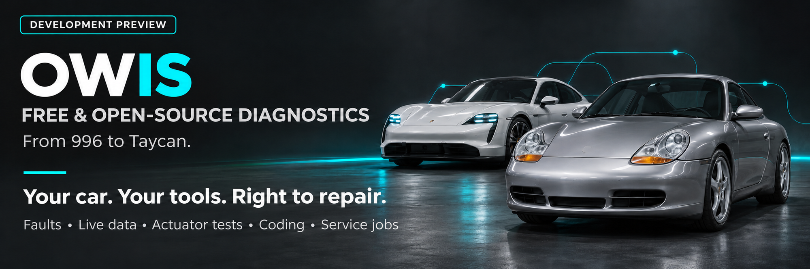
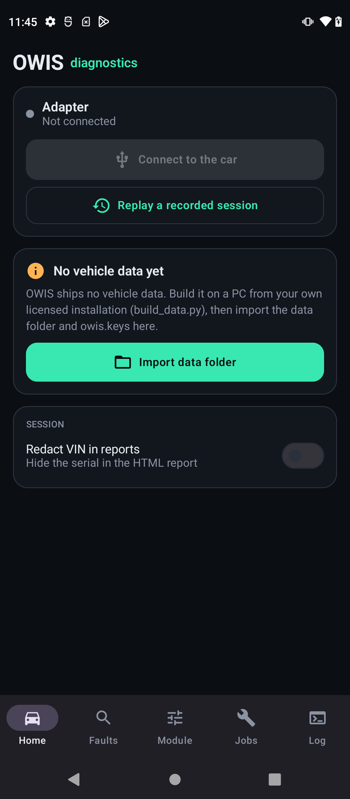
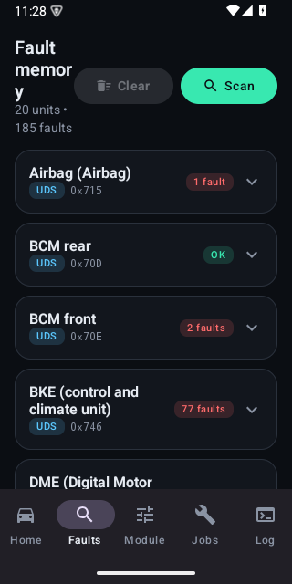
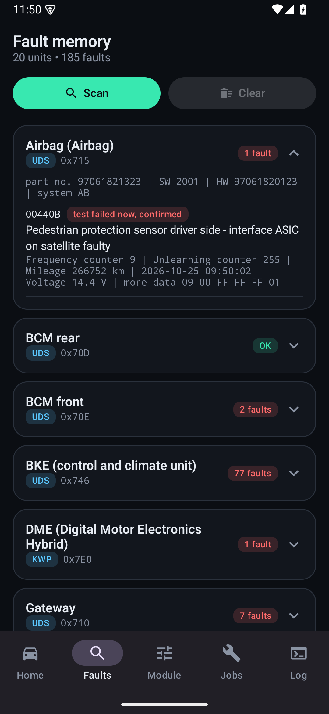
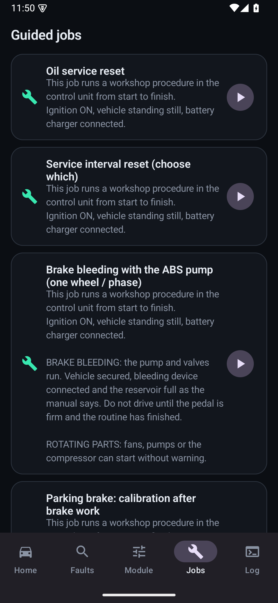

<p align="center">
  
</p>

<h1 align="center">OWIS for Android</h1>

<p align="center">
  <b>Open Workshop Information System — Porsche diagnostics on your phone.</b><br>
  The same engine as desktop <a href="https://github.com/brstic/owis">OWIS</a>, over a Tactrix OpenPort 2.0 and a USB-OTG cable.
</p>

<p align="center">
  
  
  
</p>

---

> ⚠️ **Development preview — not yet confirmed on a car from the phone.** The desktop engine is confirmed on a real
> Porsche; this app wraps that same engine over USB. Try it and report back with the session log.

## Screenshots

<p align="center">
  
  
  
  
</p>

<p align="center"><sub>Home · scan of every control unit · a fault with its freeze-frame data · guided jobs.
Home is a real phone (Moto G60, Android 12); the populated views are a replayed, VIN-redacted session.</sub></p>

## What it is

A native Android app that runs the **portable OWIS diagnostic engine** (the exact `src/*.h` from the desktop
project, compiled with the NDK) and talks to the car through a **Tactrix OpenPort 2.0** plugged into the phone with a
USB-OTG / USB-C cable. Everything the desktop tool does on the CAN bus, it does here:

- **Scan** every control unit, read and **clear faults** with their freeze-frame data.
- **Guided jobs**, one tap each: service reset, bleeding, calibrations, PDK teach-in, adaptation resets …
- **Live data** with value tiles.
- **Open any control unit** — run its actuator tests, routines and **coding writes** (the unit unlocks with its own
  seed/key, needs your `owis.keys`), watch read values live.
- **Reports** — printable HTML scan report with optional VIN redaction, shareable from the app.
- **Record / replay** — record a session to a `.ptrace` file and replay it later without the car.
- UDS & KWP2000 over ISO-TP (11/29-bit CAN) and VW TP 2.0 for the units behind the gateway, all in user space on
  top of raw CAN frames.

13 Porsche lines, Panamera 970 to Taycan — the same coverage as desktop OWIS.

## How it works

```
  Jetpack Compose UI  (Kotlin)
          │
   MainViewModel ──► Native (JNI)  ──►  libowis.so
          │                               │  engine/*.h  (scan, jobs, coding, ISO-TP, TP 2.0)
          │                               │  op2_bus.h   (OpenPort 2.0 transport)
   Op2Usb (CDC-ACM) ◄───── USB bulk ──────┘  reads/writes raw CAN frames
          │
   USB-OTG → Tactrix OpenPort 2.0 → OBD → car
```

The engine is unchanged; the Android-specific parts are small and self-contained:

- **`app/src/main/cpp/op2lib/`** — the vendored **[roffe/libj2534_openport2](https://github.com/roffe/libj2534_openport2)**
  library (Apache-2.0): its J2534 PassThru implementation and OpenPort 2.0 command protocol, built with
  `-DOP2_ANDROID_USB` so only its byte I/O is replaced by Android USB bulk transfers (the `op2_usb_*` hooks).
- **`app/src/main/cpp/op2_bus.h`** — drives that library's `PassThru*` API to move raw CAN frames; OWIS's own
  `isotp.h` / `tp20.h` run ISO-TP and VW TP 2.0 on top.
- **`app/src/main/java/com/owis/diag/usb/Op2Usb.kt`** — opens the adapter over the Android USB host API (bulk
  transfers on the CDC-data interface) and hands the bytes to native code.
- **`owis_jni.cpp`** — the JNI bridge: the engine runs in native code, USB I/O and log/live callbacks cross back to
  Kotlin.

K-line (996 / 986 / 955) is not available over the OpenPort 2.0 yet — those cars need an adapter that does the K-line
init. Everything on CAN works.

## Vehicle data (and coding keys)

Like desktop OWIS, the app **ships no vehicle data**. Build it once on a PC from your own licensed installation and
copy it to the phone:

1. On a PC, in the [OWIS](https://github.com/brstic/owis) repo, run `build_data.py` to produce the `data/` folder,
   and `tools/seedkey` + `build_keyfile.py` to produce `owis.keys` (coding; optional).
2. Copy the `*.json` packs and `owis.keys` into one folder on the phone.
3. In the app, **Import data folder** and pick it (or push the files to
   `Android/data/com.owis.diag/files/data/` directly).

Without data, the app explains what to add; without `owis.keys`, everything except coding writes works.

## Build

Needs Android Studio (or the command-line tools) with **NDK 27** and **CMake 3.22**.

```sh
./gradlew :app:assembleDebug        # app/build/outputs/apk/debug/app-debug.apk
```

The engine headers under `app/src/main/cpp/engine/` are vendored from the desktop repo; refresh them with
`tools/sync-engine.sh ../porsche-tool`.

## What is verified

- **Software, on an Android device:** the engine test suite builds with the NDK and **passes on-device** —
  scan, fault + freeze-frame decode, **coding writes** (`0x27` unlock + `0x2E`, wrong-key rejection, no-key
  handling), **K-line KWP2000 SecurityAccess**, **guided jobs** (PDK teach-in with its conditions), **VW TP 2.0**
  and live data, all against the built-in simulated car. Run it yourself:

  ```sh
  tools/run-engine-tests.sh <your data pack>.json      # on a connected device/emulator -> "ALL ENGINE TESTS PASSED"
  ```

  The app itself also runs on-device (the screenshots above are a real, replayed session).
- **Hardware, bench-tested:** the engine was run against a **real Tactrix OpenPort 2.0** (firmware 1.17.4877) from a
  desktop over its serial port with `tools/op2-cli` (same engine + the same vendored `op2lib/op2.c`): the adapter
  opened, the 500 kbit/s CAN channel came up and the VIN request went out on the real hardware. The real firmware also
  accepts the **ISO 14230 (K-line) channel** (`ato4 10400` → `aro`), so the K-line path establishes its channel on the
  adapter; its init + exchange still need an old K-line car to confirm. On the bench there is no car, so no ECU answers.

  ```sh
  tools/op2-cli/build.sh                                   # builds ./op2-cli for macOS/Linux
  ./op2-cli /dev/cu.usbmodemXXXX <data-dir> probe          # or: detect | scan  (plug into the car's OBD port)
  ```
- **Not yet verified:** a full scan on a **car** (needs the adapter in the OBD port with the ignition on), and K-line
  init over the adapter (the OpenPort 2.0 library stubs the fast-init). This is the **same open item as desktop
  OWIS**, whose on-car confirmation is also pending. Please report back with a recorded session.

## Hardware

- A **Tactrix OpenPort 2.0** (VID `0403`, PID `CC4B/CC4C/CC4D`).
- A **USB-OTG** adapter/cable for your phone (USB-C or micro-USB host mode).
- Ignition on, engine off, a battery charger recommended.

## Credits

- Diagnostic engine: [OWIS](https://github.com/brstic/owis) (MIT).
- OpenPort 2.0 J2534 library: [roffe/libj2534_openport2](https://github.com/roffe/libj2534_openport2) (Apache-2.0),
  vendored under `app/src/main/cpp/op2lib/` with its `LICENSE` and `NOTICE`.

---

Not affiliated with or endorsed by Porsche AG; "Porsche" only names the compatible vehicles. Use at your own risk and
follow the workshop manual. MIT license (the vendored OpenPort 2.0 library is Apache-2.0).
